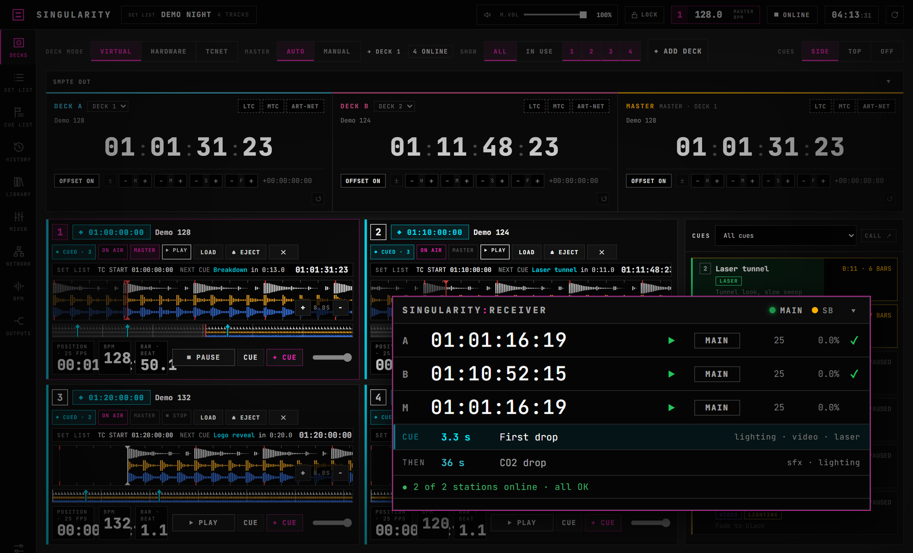
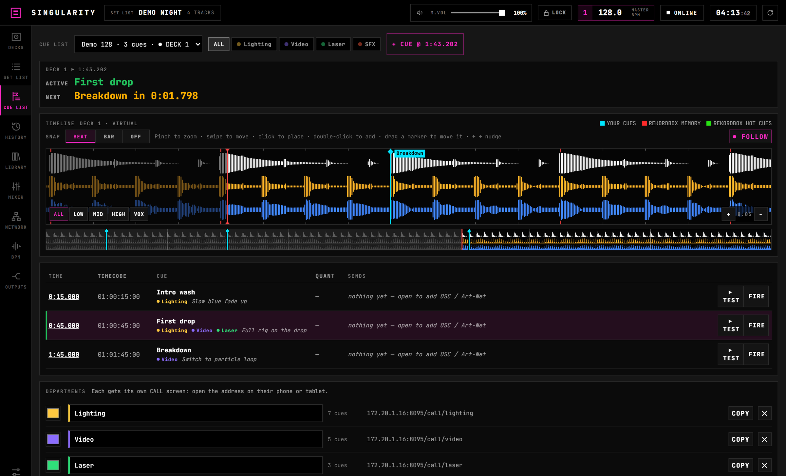
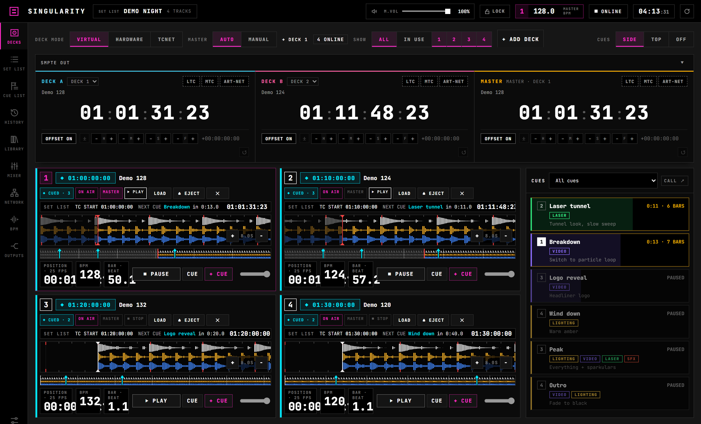
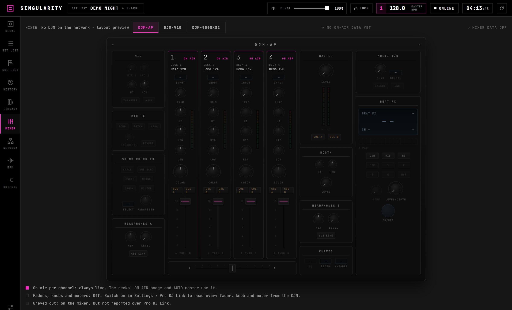
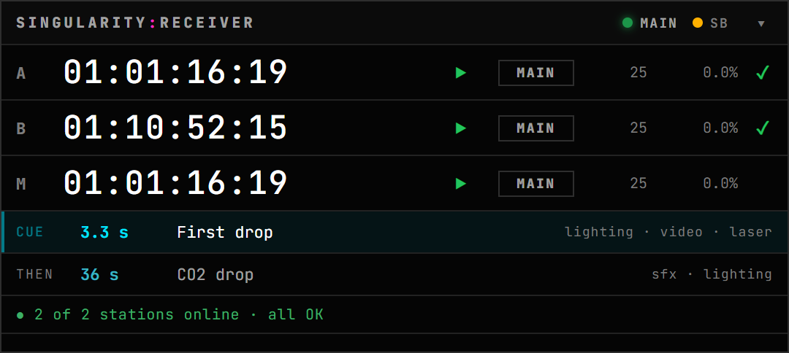
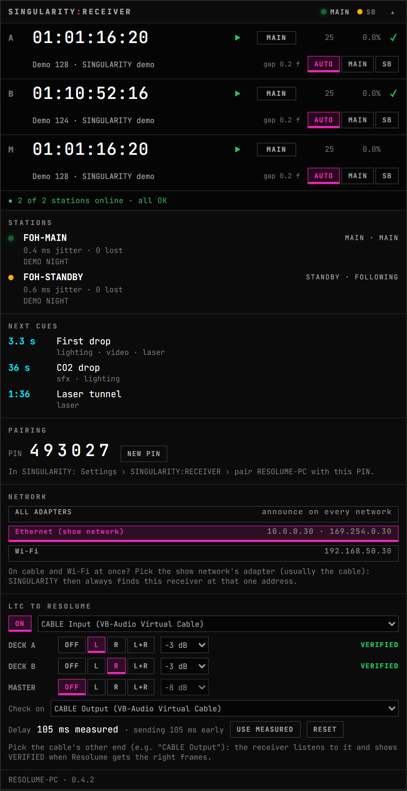
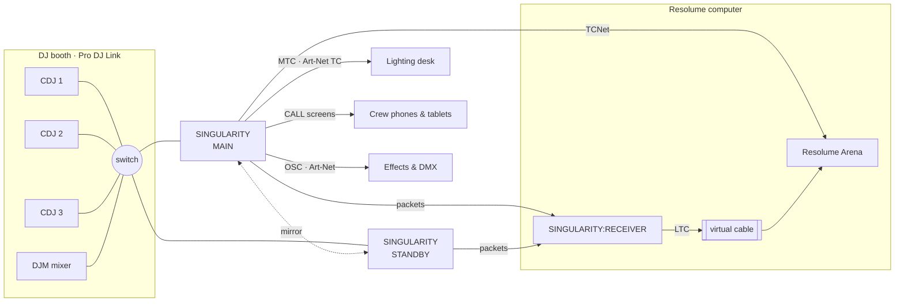

# S I N G U L A R I T Y

**TIMECODE · PRO DJ LINK · CUE**

*The point where the DJ's decks and the whole show become one timeline.*

[**Download**](#download) · [What it does](#the-idea) · [A night with SINGULARITY](#a-night-with-singularity) · [SINGULARITY:RECEIVER](#singularityreceiver) · [Updates](#updates)

---

## The idea

A DJ never plays the same set twice. Your lights, video, lasers and effects still have to land on the drop.

**SINGULARITY** listens to every CDJ on the Pro DJ Link network: what's loaded, where the playhead is, the pitch, the beat. It turns all of that into **one live show state**, then sends it to the rest of the production as timecode, cues and tempo.

Each track in the set list gets its own timecode start. When the DJ loads a track and presses play, Resolume jumps to that track's clips, the lighting desk follows its timeline, and every department's screen counts down to its next cue. No pre-rendered show, no timecode track baked into the music. The DJ plays freely, and the show follows.

> **Event horizon** */ˈɪv(ə)nt həˈrʌɪz(ə)n/*: the edge past which nothing escapes.
> In SINGULARITY: the moment a deck starts and everything on stage falls into sync.

---

## A night with SINGULARITY

<table>
<tr><td width="38%" valign="top">

### 18:00 · Build the set list
Load the night's tracks. Each one gets a timecode start (01:00:00:00, 01:10:00:00…), so every track has its own place in Resolume or on the lighting desk.

Drop cues on the waveform, such as **"CO2 drop"** or **"Laser tunnel"**. Assign each one to its departments, with a note and how many bars of warning they get.

</td><td>

</td></tr>
<tr><td valign="top">

### 21:00 · Doors
SINGULARITY joins the CDJ network, never on a player number the CDJs need. Every deck's timecode runs **frame by frame from the playhead, at the deck's pitch**, phase-locked so it never drifts or steps.

**TCNet** goes to Resolume, **SMPTE LTC** to anything with an audio input, and **MTC** and **Art-Net Timecode** to lighting desks.

</td><td>

</td></tr>
<tr><td valign="top">

### 23:40 · The drop
Every department sees its own calls on its own screen: **STANDBY** eight bars out, a countdown, then **GO**. Fired cues can send OSC and Art-Net themselves.

Mixer data comes in from a networked DJM too: channel faders, crossfader, on-air state, and every knob and button the mixer reports, laid out like the hardware.

</td><td>

</td></tr>
<tr><td valign="top">

### 01:15 · A laptop dies
Run two SINGULARITYs: a **MAIN** and a **STANDBY** that mirrors its set list and settings, with its outputs held.

If the main goes silent, the standby takes over by itself (**about 4.6 s** in our tests) and stays in charge until you press **HAND BACK**. The two never send at once, even when the main comes back on its own.

</td><td>

</td></tr>
</table>

---

## SINGULARITY:RECEIVER

**Timecode that survives the network.** A small always-on-top app for the Resolume computer.

<table>
<tr><td width="45%" valign="top">

Both SINGULARITYs send it **timecode packets, not audio**. The receiver makes the LTC **on the Resolume computer itself**, into a virtual audio cable that Resolume reads as its SMPTE input. Wi-Fi hiccups, audio relays and long cables are out of the path.

- **Failover per output.** It follows the main and switches to the standby if the main's packets stop, with no jump on Resolume's timeline. Both machines play the same set list, so the frames line up.
- **Proof it works.** A read-back check listens to the other end of the cable and shows **VERIFIED** when Resolume is getting the right frames. It also measures the path's delay and compensates for it.
- **Your cues on top.** It shows the next cue and the one after, counting down and pulsing as they get close.
- **Paired by PIN.** It only takes timecode from your own SINGULARITYs, and every packet is signed.
- **Made to sit on top.** Always on top, adjustable opacity, click-through (Ctrl+Alt+R) and a lock, so it can float over Resolume all night.

</td><td>

</td></tr>
</table>

---

## How a show is wired

---

## Spec sheet

| | |
|---|---|
| **Reads** | Pioneer DJ Pro DJ Link: players, track data, beat grids, waveforms. Networked DJM mixers (faders, on-air, knobs and buttons they report). Built-in virtual decks for preparing a show without hardware. |
| **Timecode out** | TCNet · SMPTE LTC (per output: device, channel, level) · MIDI Timecode · Art-Net Timecode · SINGULARITY:RECEIVER |
| **Outputs per show** | DECK A, DECK B and MASTER, each following a chosen deck or the master, with per-track start times and live offsets |
| **Cues** | Per track, on the waveform, by department. A CALL screen for each department, in a browser. OSC and Art-Net actions. |
| **Tempo** | Master BPM to OSC (Resolume tempo, BPM or beat) |
| **Redundancy** | MAIN / STANDBY mirror with automatic takeover and HAND BACK. Receiver failover per output. |
| **Network** | Choose the adapter for Pro DJ Link, TCNet, the mirror and the receiver, so a laptop on cable and Wi-Fi never wanders onto the wrong network |
| **Crew access** | Web UI for the crew. Pair devices by PIN as CREW (view only) or OPERATOR. Show lock. |
| **API** | The full live show state as JSON over WebSocket, for TouchDesigner, Unreal, Notch or your own tools |
| **Runs on** | Windows 10/11 (x64) · macOS on Apple Silicon. Everything it needs is built in, FFmpeg included. |

---

## Download

Installers are on the **[Releases](../../releases)** page:

| | Windows (x64) | macOS (Apple Silicon) |
|---|---|---|
| **SINGULARITY** | `SINGULARITY-Setup-<version>.exe` | `SINGULARITY-<version>-mac-arm64.dmg` |
| **SINGULARITY:RECEIVER** | `SINGULARITY-RECEIVER-Setup-<version>.exe` | `SINGULARITY-RECEIVER-<version>-mac-arm64.dmg` |

SINGULARITY needs a licence key from [Layers of Time Studio](https://layersoftime.studio). SINGULARITY:RECEIVER works with any licensed SINGULARITY.

> **First open on a Mac:** the apps aren't notarised by Apple yet, so right-click the app › **Open** the first time.
> **Windows SmartScreen** may warn on first run until the installers are code-signed: choose **More info › Run anyway**.

## Updates

Every version is published here first. From **0.5**, both apps check this page and offer the update inside the app:
- one click to install, with the release notes shown first;
- never on their own, and never while **Show lock** is on;
- with a mirror, update the **standby first**, then the main, then press **HAND BACK**.

Versions: 0.x is the public beta. A patch (0.4.1, 0.4.2…) is a fix release; a new minor (0.5.0) is a new milestone.

---

**SINGULARITY** is made by **[Layers of Time Studio](https://layersoftime.studio)**: show control from people who run shows.

SINGULARITY // LOT © 2026 LAYERS OF TIME // LOT. All rights reserved. This repository holds release builds and notes only. The source code is private.
Pioneer DJ, Pro DJ Link, rekordbox, CDJ, DJM, Resolume, Arena and TCNet are trademarks of their respective owners. SINGULARITY is not affiliated with or endorsed by them.
Third-party components and their licences, including FFmpeg (LGPL), are listed in each release's THIRD-PARTY-NOTICES.

